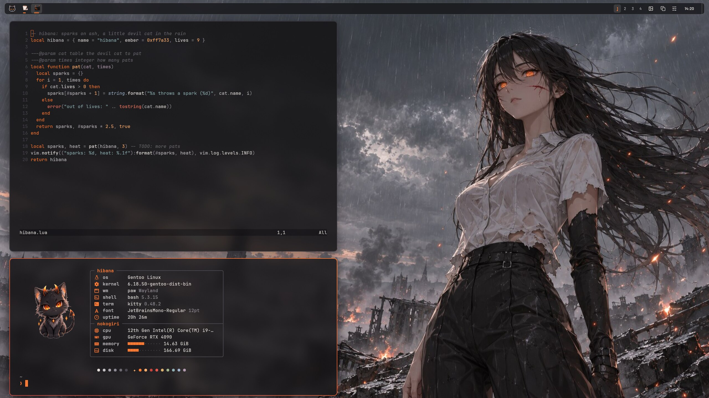
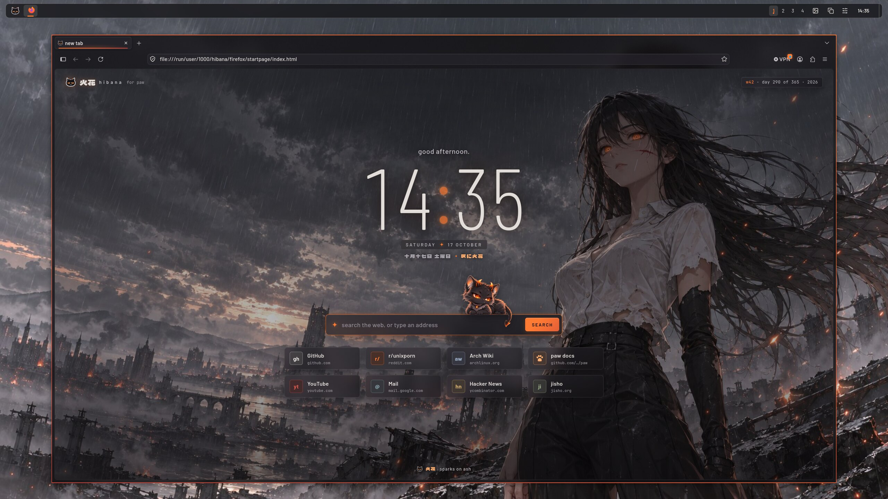
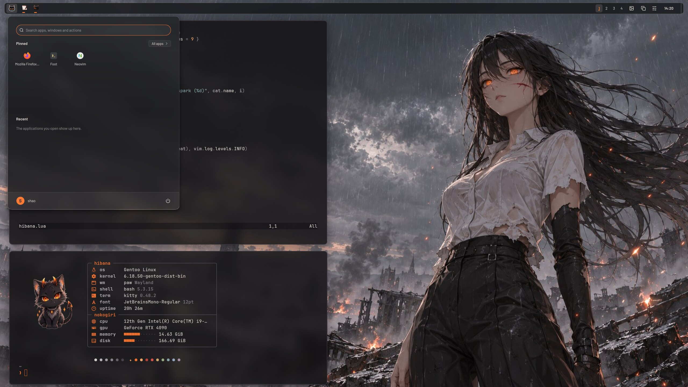
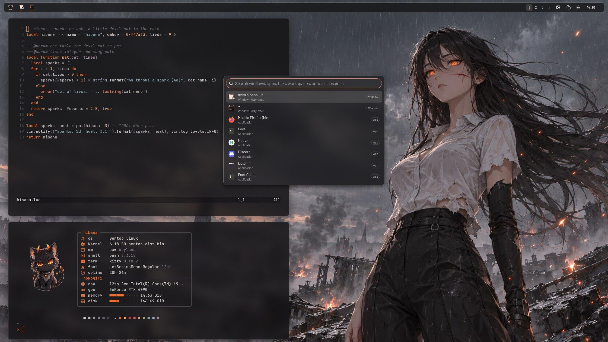
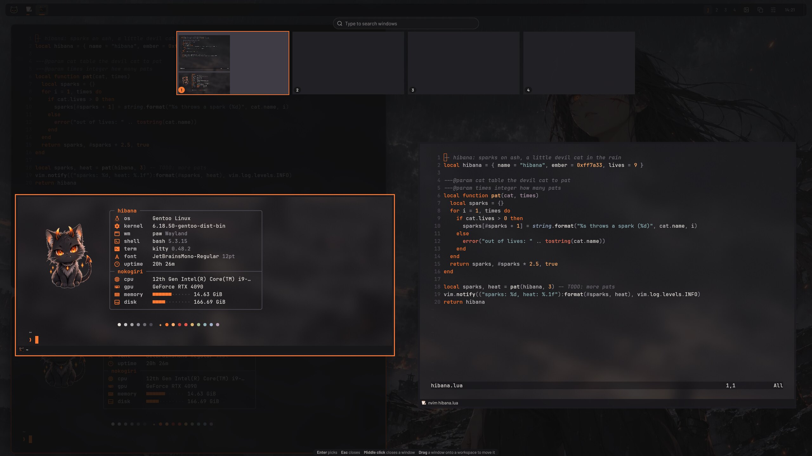
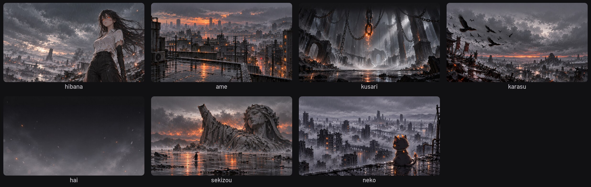
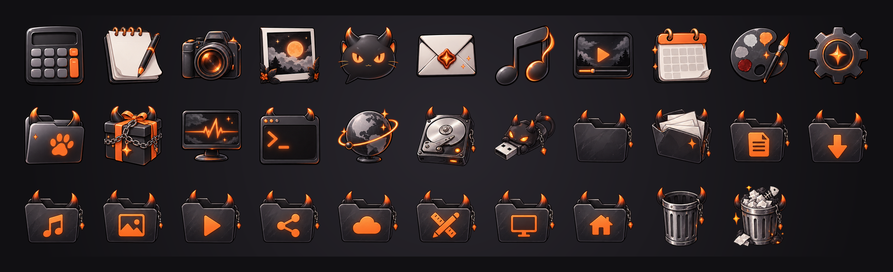
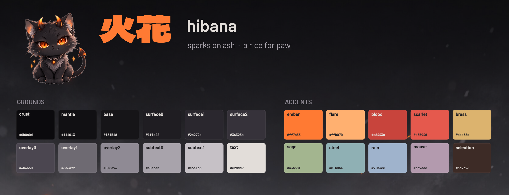

<div align="center">

# 火花 hibana

<i>Sparks on ash.</i>

A rice for [paw](../../README.md): grey storms over cities in the rain, ink-grey glass, paper-white
text, and ember orange burning through it all, with a little blood red. Its mascot is a small
black devil cat with ember eyes and horns that burn at the tips. *Hibana* is Japanese for sparks.



</div>

## The look

hibana is dark, cool and quiet, with one hot colour. The greys carry the faint mauve of a storm
sky, never quite black; the text is the warm white of a shirt in the rain rather than white; and
ember orange is the accent everywhere something has your attention: the focused window's border
(burning down into blood red), the current tab, the cursor, the selection in a menu, Claude in
Claude Code. Red stays rare and deep, for errors and the end of a gradient. The rest of the
palette is muted and cool, so it never competes with the embers: brass for types and warnings,
sage for what was added, the steel teal of weathered stone for strings, and a pale rain blue
for links and for you.

Terminals, editors and Firefox's toolbars are glass, a rainy window onto the wallpaper that paw
blurs and darkens behind them, with a little film grain over it. The corners are sharper than
mochi's, the shadows deep and soft. The cat turns up where it can: on the start button, in
fastfetch, lying on the Firefox start page's search card, and on the icons, whose folders grow
little horns.

| | |
| --- | --- |
|  |  |
| Firefox and its start page, the cat lying on the search card | The start menu on glass, the search burning at the edge |
|  |  |
| The command palette | The overview |







## The palette

| | Grounds | | | Accents | |
| --- | --- | --- | --- | --- | --- |
| crust | `#0b0a0d` | the deepest shadow | ember | `#ff7a33` | the accent |
| mantle | `#111013` | floats, sidebars | flare | `#ffb070` | hot highlights, numbers |
| base | `#161518` | the ground | blood | `#c8443c` | a subtle red |
| surface0 | `#1f1d22` | cards, the cursor line | scarlet | `#e5594d` | errors |
| surface1 | `#2a272e` | raised | brass | `#dcb36e` | types, warnings |
| surface2 | `#36323a` | selected, inactive borders | sage | `#a3b58f` | success, additions |
| overlay0 | `#4b4650` | rules, scrollbars | steel | `#8fb0b4` | strings |
| overlay1 | `#6e6a72` | comments | rain | `#9fb3cc` | links, you |
| overlay2 | `#8f8a94` | muted text | mauve | `#b39aae` | the storm, sparingly |
| subtext | `#a8a3ab`, `#c6c1c6` | secondary text | selection | `#3d2b26` | a smoky ember wash |
| text | `#e2ddd9` | paper | | | |

## What is in it

| Part | Files | What it does |
| --- | --- | --- |
| paw | the `hibana` profile in [`config/init.lua`](../../config/init.lua), and [`start/`](start) | The glass bar, ember-to-blood borders, deep shadows, colours, font, wallpaper and the devil cat on the start button (`shell.start_icon`). Shipped with paw. |
| Wallpapers | [`wallpaper/`](wallpaper) | `hibana.jpg` and six companions, made for paw: *ame* (rain over the rooftops), *kusari* (chains, one link molten), *karasu* (crows at a red sunset), *hai* (ash and embers, calm enough to work on), *sekizou* (a fallen statue in the flood) and *neko* (the cat watching the city). |
| kitty | [`kitty/hibana.conf`](kitty/hibana.conf) | Ink glass at 80% with the editors' floats and status lines kept glass too (`transparent_background_colors`), JetBrains Mono, an ember cursor trailing blood red, ash tabs with a fire burning on the current one, and sixteen colours where amber carries the ember into the terminal. |
| fastfetch | [`fastfetch/`](fastfetch) | The devil cat, shown through kitty's graphics protocol, beside a spec sheet in a box, the hardware under *nokogiri* (the saw), and the palette in a row. |
| Firefox | [`firefox/`](firefox) | `userChrome.css` (glass toolbars, the page a card set into them, the current tab and the focused URL bar marked in ember), `userContent.css` (the new tab page as a rainy night with 火花 over glass shortcuts; the settings pages in hibana), `user.js`, and a start page: the wallpaper behind glass cards, rain falling and embers rising over it, a big clock, and the cat lying on the search card, which throws sparks when you pat it. |
| Discord | [`discord/hibana.theme.css`](discord/hibana.theme.css) | One theme for Vencord, Vesktop, Equicord, Equibop and BetterDiscord: Discord's dark themes become hibana, ember where it matters, and with window transparency on, glass. |
| Claude Code and cdeck | [`claude/hibana.json`](claude/hibana.json) | A custom theme for Claude Code (`/theme`, then `custom:hibana`), which cdeck takes its colours from: Claude in ember, you in rain blue, an ember Clawd. |
| Neovim and Helix | [`editors/`](editors) | Plugin-free colour schemes, keywords in ember, types in brass and strings in steel, that paint no background, so kitty's glass shows through the code. |
| GTK | [`gtk/gtk.css`](gtk/gtk.css) | Ink, paper and an ember accent for libadwaita applications through libadwaita's own colour variables, only while the system prefers dark. |
| Icons | [`icons/Hibana`](icons/Hibana) | `Hibana`, an icon theme of 32 applications, places and devices in ash and ember, folders with little horns, over a Tela recoloured to match. |

## Using it

**paw.** The profile ships with paw: pick **hibana** from the panel's Appearance menu or the
command palette, or run `paw msg profile hibana`. A configuration with `extends = "default"` and
no profiles of its own offers it. One with profiles of its own copies `hibana` from
[`config/init.lua`](../../config/init.lua) into its `profiles` table and names the wallpaper by
its installed path, for example `wallpaper = "/usr/share/paw/rices/hibana/wallpaper/hibana.jpg"`
(`/usr/local/share` for a build installed with the default prefix). The profile sets the system
to prefer dark (`appearance.color_scheme`), which GTK, Firefox and Discord follow.

**The applications.** `install.sh` puts the rest in place; it is installed with paw at
`share/paw/rices/hibana/install.sh`, or run it from here:

```sh
rices/hibana/install.sh --dry-run       # what it would change
rices/hibana/install.sh                 # kitty, fastfetch, Firefox, Discord, Claude Code, editors, GTK, wallpapers
rices/hibana/install.sh kitty discord   # only some of them
rices/hibana/install.sh --fonts --icons --cursor
```

It keeps a copy of every file it replaces (`FILE.hibana-backup`, the first time), puts the lines
it adds to your own files between `paw hibana` markers, and changes nothing new when run again.
It leaves paw's configuration and Discord itself alone. The wallpapers go where paw's wallpaper
picker looks, in a `hibana` folder of their own: `Pictures/wallpapers/hibana`, or
`Pictures/hibana` when there is no `wallpapers` folder. What the options download, each pinned
to a release or a commit:

- `--fonts`: Barlow (the bar's industrial sans, Firefox's and Discord's too, as single weights
  from [google/fonts](https://github.com/google/fonts/tree/690b65d64dabaebf9d18e2d7e8c8e7e02b4cccaf/ofl/barlow),
  with Barlow Condensed's thin weights for the start page's clock), Dela Gothic One (火花 and the
  other Japanese headings, in a heavy manga hand), JetBrains Mono
  2.304 and the Nerd Fonts 3.5.1 symbols, about 13 MB, into `~/.local/share/fonts/paw-hibana`. All
  under the SIL Open Font License, the symbols under MIT.
- `--icons`: the [Tela icon theme](https://github.com/vinceliuice/Tela-icon-theme) (2026-07-07),
  installed with its folders in ash and their symbols in ember as `Tela-hibana-black` (and
  `-light`, `-dark`), and over it hibana's own icons as `Hibana` (`icons/Hibana`), which fills in
  from `Tela-hibana-black-dark`: uncomment `icon_theme = "Hibana"` in the `hibana` profile to
  have it while hibana is in use, or `gsettings set org.gnome.desktop.interface icon-theme Hibana`
  to keep it.
- `--cursor`: [Bibata](https://github.com/ful1e5/Bibata_Cursor) Modern Classic 2.0.7, black with
  a white edge: add `cursor_theme = "Bibata-Modern-Classic"` to the `hibana` profile's
  `appearance`, or
  `gsettings set org.gnome.desktop.interface cursor-theme Bibata-Modern-Classic`.

**The glass.** paw blurs what shows through a translucent window. kitty is translucent as it
is (kitty 0.37 or newer keeps the editors' floats and status lines glass too), and Neovim and
Helix paint no background of their own; in a terminal without translucency, give it hibana's
base, `#161518`. Firefox's toolbars are glass while `hibana.glass` is true in `user.js` (it is);
set it to false for solid toolbars.

**Discord** cannot load a theme itself: `install.sh` puts it in the themes folder of Vencord,
Vesktop, Equicord, Equibop or BetterDiscord where one is installed, and you turn it on in their
settings, with Discord on a dark theme (Appearance → Dark, or Sync with computer). For glass,
turn on **Enable window transparency** in Vencord's (or Equicord's) settings, restart Discord,
and put this in QuickCSS:

```css
:root { --hibana-glass: 1; }
```

0 is solid (the default, and the right value without window transparency), 1 hibana's glass,
and values in between work too. Client mods are against Discord's terms.

**Firefox** picks the theme up when it restarts. The first tab and every new tab show Firefox's
own new tab page, styled to match the start page; to open the start page itself at home instead,
uncomment its line in `user.js`. hibana's Firefox chrome is dark whatever the system prefers.

**GTK.** The lines `install.sh` adds to `~/.config/gtk-4.0/gtk.css` recolour libadwaita 1.6
and newer through its colour variables while the system prefers dark, and leave its shapes
alone. GTK 3 applications keep their theme.

**Beside washi and mochi.** The rices install side by side, but some places hold only one look:
Firefox's `chrome/` folder takes the last one installed; kitty uses whichever block comes last in
`kitty.conf`; and GTK 4 the last block in `gtk.css` (remove the others' blocks, or run that
rice's `install.sh` part again). In Discord, turn on one theme at a time.

## What paw does for it

- **`windows.blur`**, the storm blurred behind windows: kitty, the editors in it, Firefox's
  toolbars and Discord with transparency let it through, frosted, darker, with a film grain.
- **`shell.blur`**, glass for the bar and every popup: the start menu, Quick Settings, the
  calendar, notifications, the command palette and Alt + Tab.
- **Gradient borders**, ember burning down into blood red on the focused window.
- **`shell.start_icon`** puts the devil cat on the start button.
- **`appearance.color_scheme = "dark"`** takes GTK, Firefox and Discord into their dark styles
  with the profile.
- **Profiles** switch all of it at once.

## Credits

The palette, the themes and everything else here are paw's and under its licence,
GPL-3.0-or-later; the wallpapers, the start button, the fastfetch picture, the start page's cat
and the `Hibana` icons are made for paw, the pictures with OpenAI's image model through Codex.
They are original: the colours were inspired by the grey storms and ember eyes of an anime's
war-torn city, but no character, name or mark of it is used. The wallpapers are 1672 by 941 for
now, the size that model draws. Nothing else is bundled: the fonts (Barlow and Barlow Condensed by Jeremy Tribby; Dela
Gothic One by artakana; JetBrains Mono by JetBrains; the Nerd Fonts symbols), the Tela icons
(vinceliuice, GPL-3.0) and the Bibata cursors (Abdulkaiz Khatri, GPL-3.0) are downloaded by
`install.sh` from their own releases, under their own licences.
