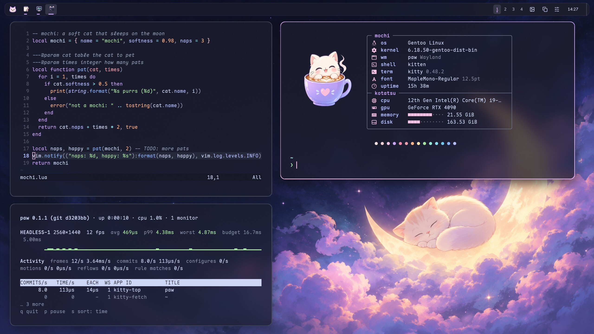
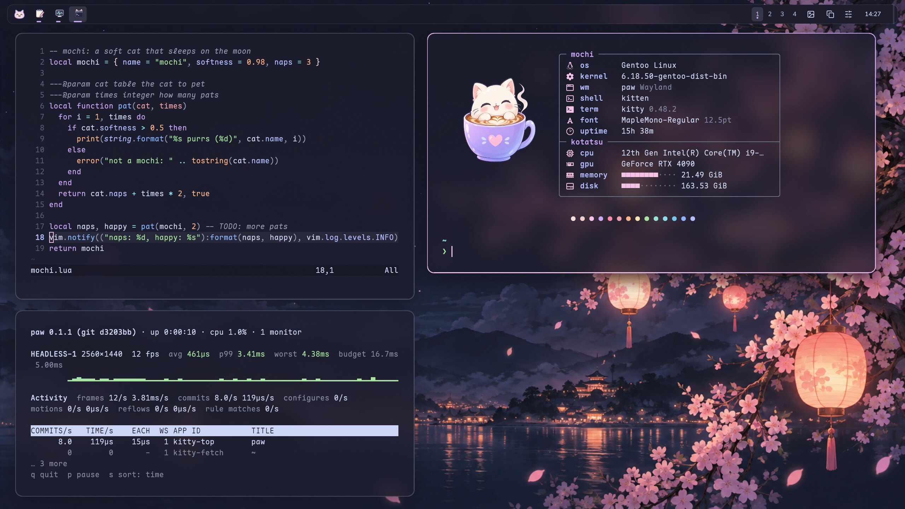
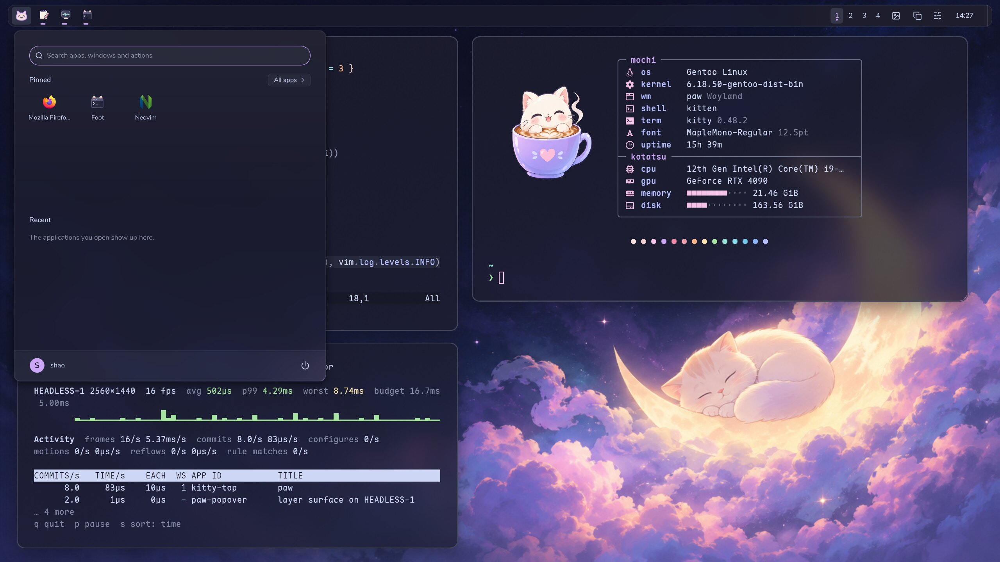
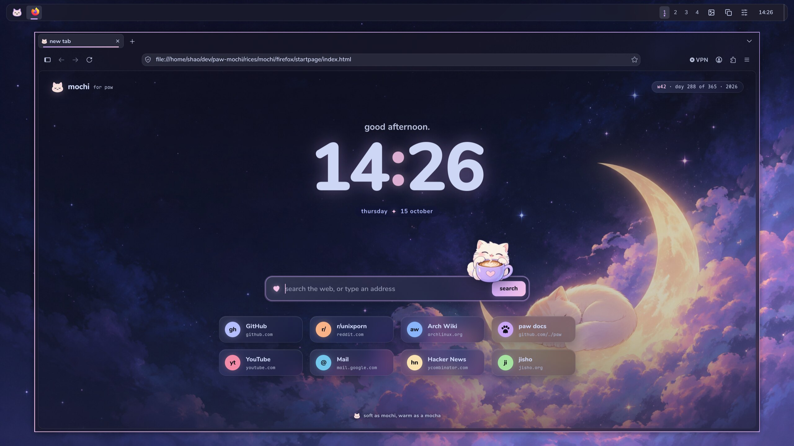
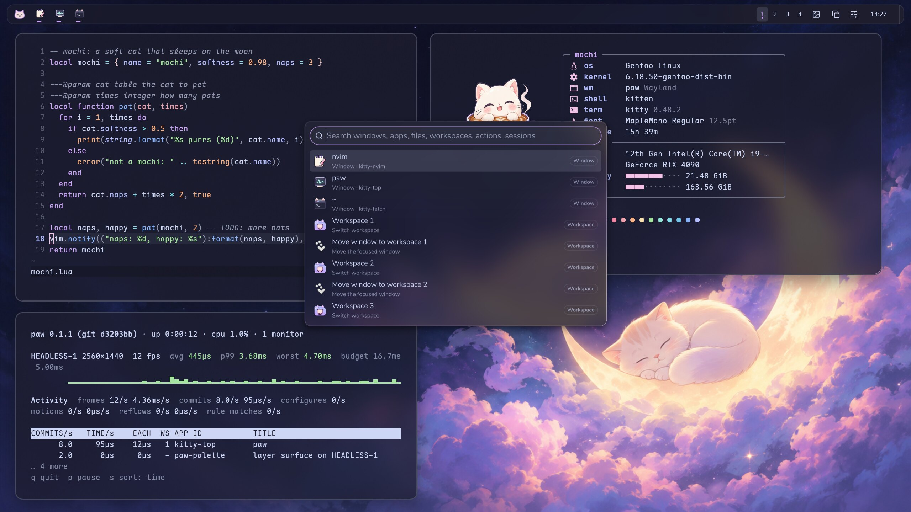
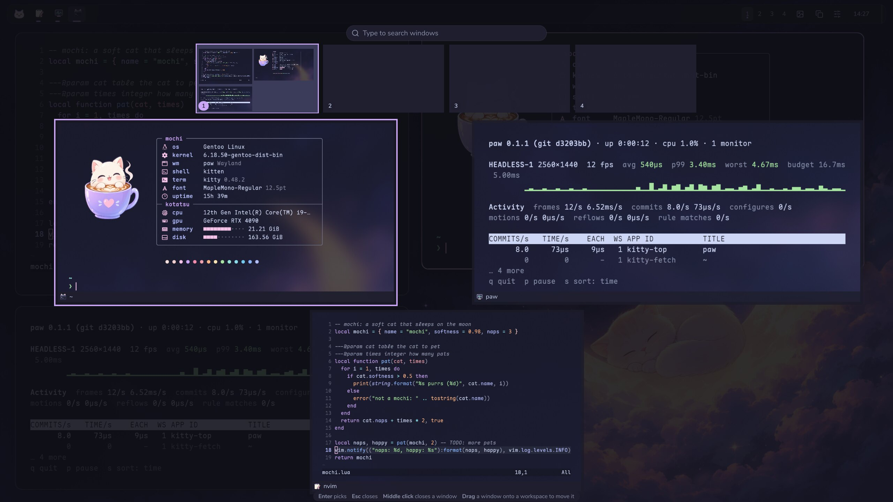
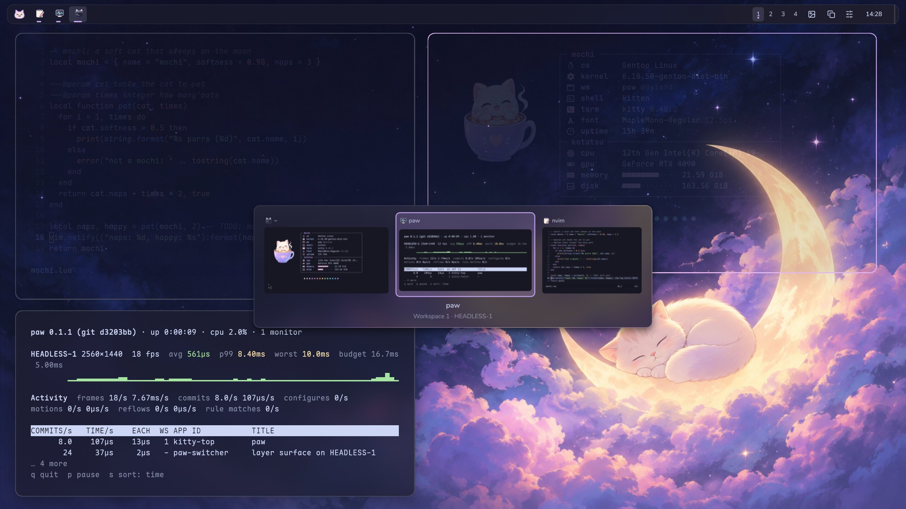
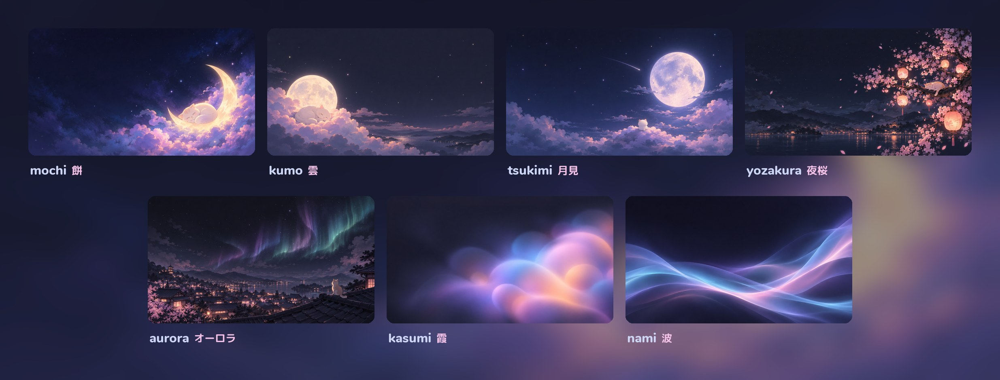
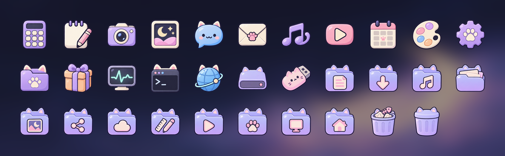
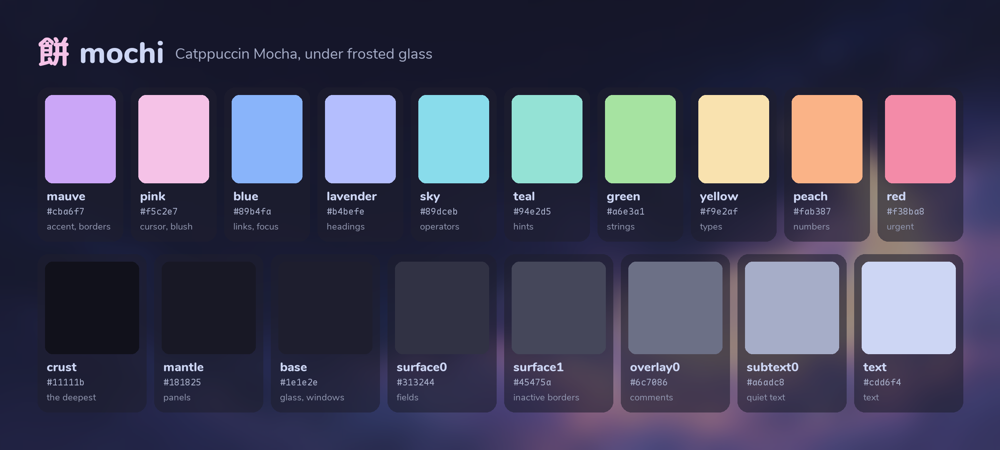

<div align="center">

# 餅 mochi

<i>Soft as mochi, warm as a mocha.</i>

A rice for [paw](../../README.md): [Catppuccin Mocha](https://github.com/catppuccin/catppuccin)
under frosted glass, with a round, cream-white cat as soft as the rice cake it is named after.
Catppuccin is cat plus cappuccino; mochi is the nod to Mocha.



</div>

## The look

mochi is dark and see-through. Terminals, editors and Firefox's toolbars are glass: Mocha's base
lets the wallpaper through and paw blurs it, so the text sits on a frosted night instead of a
slab of colour. Everything keeps Catppuccin Mocha's palette exactly, and its manners: text in
Mocha's soft lavender white rather than white, mauve as the accent, pink for the little marks of
attention (the cursor, the selection, a mention), blue for links and focus, and the syntax as
Catppuccin colours it, keywords mauve, strings green, functions blue, types yellow, numbers
peach. The contrast stays gentle, the corners round, the shadows soft, and the cat turns up
where it can: in fastfetch, on the Firefox start page, on the start button, in the tab bar.

| | |
| --- | --- |
|  |  |
| The glass over another wallpaper: the sakura blurred behind kitty | The start menu on glass, with the Mochi icons |
|  |  |
| Firefox and its start page, the cat on the search card | The command palette, frosted |
|  |  |
| The overview | Alt + Tab with live pictures of the windows |







## What is in it

| Part | Files | What it does |
| --- | --- | --- |
| paw | the `mochi` profile in [`config/init.lua`](../../config/init.lua), and [`start/`](start) | The bar, borders, shadows, colours, font, wallpaper and the cat on the start button (`shell.start_icon`). Shipped with paw. |
| Wallpapers | [`wallpaper/`](wallpaper) | `mochi.jpg` and its companions, made for paw. |
| kitty | [`kitty/mochi.conf`](kitty/mochi.conf) | Mocha at 84% opacity, with the backgrounds editors paint kept glass too (`transparent_background_colors`), Maple Mono, a pink cursor with a periwinkle trail, quiet tabs with a cat on the current one, a thin scrollbar. |
| fastfetch | [`fastfetch/`](fastfetch) | The cat, shown through kitty's graphics protocol, beside a spec sheet in a box (the hardware under the *kotatsu*, where cats sleep), and Catppuccin's fourteen accents in a row. |
| Firefox | [`firefox/`](firefox) | `userChrome.css` (toolbars as glass, the page a rounded card set into it, the URL bar and tabs as softer panes, menus and panels in Mocha), `userContent.css` (the new tab page as a night with mochi's name and frosted shortcuts; the settings pages in Mocha), `user.js`, and a start page you can make the home page: the wallpaper behind frosted cards, a big clock, a search card with the cat sitting on it, and hearts when you pat it. |
| Discord | [`discord/mochi.theme.css`](discord/mochi.theme.css) | One theme for Vencord, Vesktop, Equicord, Equibop and BetterDiscord: Discord's dark themes become mochi, and with window transparency on, glass. |
| Claude Code and cdeck | [`claude/mochi.json`](claude/mochi.json) | A custom theme for Claude Code (`/theme`, then `custom:mochi`), which cdeck takes its colours from: Claude in mauve, you in blue, a cream Clawd. |
| Neovim and Helix | [`editors/`](editors) | Plugin-free colour schemes in Catppuccin's syntax style that paint no background, so kitty's glass shows through the code. |
| GTK | [`gtk/gtk.css`](gtk/gtk.css) | Mocha and a mauve accent for libadwaita applications through libadwaita's own colour variables, only while the system prefers dark. |

## Using it

**paw.** The profile ships with paw: pick **mochi** from the panel's Appearance menu or the
command palette, or run `paw msg profile mochi`. A configuration with `extends = "default"` and
no profiles of its own offers it. One with profiles of its own copies `mochi` from
[`config/init.lua`](../../config/init.lua) into its `profiles` table and names the wallpaper by
its installed path, for example `wallpaper = "/usr/share/paw/rices/mochi/wallpaper/mochi.jpg"`
(`/usr/local/share` for a build installed with the default prefix). The profile sets the system
to prefer dark (`appearance.color_scheme`), which GTK, Firefox and Discord follow.

**The applications.** `install.sh` puts the rest in place; it is installed with paw at
`share/paw/rices/mochi/install.sh`, or run it from here:

```sh
rices/mochi/install.sh --dry-run       # what it would change
rices/mochi/install.sh                 # kitty, fastfetch, Firefox, Discord, Claude Code, editors, GTK, wallpapers
rices/mochi/install.sh kitty firefox   # only some of them
rices/mochi/install.sh --fonts --icons --cursor
```

It keeps a copy of every file it replaces (`FILE.mochi-backup`, the first time), puts the lines
it adds to your own files between `paw mochi` markers, and changes nothing new when run again.
It leaves paw's configuration and Discord itself alone. The wallpapers go where paw's wallpaper
picker looks, in a `mochi` folder of their own: `Pictures/wallpapers/mochi`, or `Pictures/mochi`
when there is no `wallpapers` folder. What the options download, each pinned
to a release or a commit:

- `--fonts`: Nunito (the rounded sans of the bar, Firefox and Discord, as single weights from
  [google/fonts](https://github.com/google/fonts/tree/3bdd17c90e2160a99205a43cb56d60fba5847eca/ofl/nunito)),
  M PLUS Rounded 1c Regular and Bold (Japanese in the same rounded hand), Maple Mono 7.9 and the
  Nerd Fonts 3.5.1 symbols, about 13 MB, into `~/.local/share/fonts/paw-mochi`. All under the
  SIL Open Font License, the symbols under MIT; M PLUS Rounded 1c carries its licence in the
  font files.
- `--icons`: the [Tela icon theme](https://github.com/vinceliuice/Tela-icon-theme) (2026-07-07),
  installed with its folders in mauve as `Tela-mochi-purple` (and `-light`, `-dark`), and over it
  mochi's own icons as `Mochi` (`icons/Mochi`), which fills in from `Tela-mochi-purple-dark`:
  uncomment `icon_theme = "Mochi"` in the `mochi` profile to have it while mochi is in use, or
  `gsettings set org.gnome.desktop.interface icon-theme Mochi` to keep it.
- `--cursor`: [Catppuccin's cursors](https://github.com/catppuccin/cursors) 2.0.0 in Mocha
  Light, cream like the cat: uncomment `cursor_theme = "catppuccin-mocha-light-cursors"` in the
  `mochi` profile, or
  `gsettings set org.gnome.desktop.interface cursor-theme catppuccin-mocha-light-cursors`.

**The glass.** paw blurs what shows through a translucent window. kitty is translucent as it
is (kitty 0.37 or newer keeps the editors' floats and status lines glass too), and Neovim and
Helix paint no background of their own; in a terminal without translucency, give it Mocha's
base, `#1E1E2E`. Firefox's toolbars are glass while `mochi.glass` is true in `user.js` (it is);
set it to false for solid toolbars. `browser.tabs.allow_transparent_browser`, commented out
in `user.js`, clears the new tab page too, so the window's glass is all there is behind the
shortcuts, at the cost of making any page that paints no background see-through.

**Discord** cannot load a theme itself: `install.sh` puts it in the themes folder of Vencord,
Vesktop, Equicord, Equibop or BetterDiscord where one is installed, and you turn it on in their
settings, with Discord on a dark theme (Appearance → Dark, or Sync with computer). For glass,
turn on **Enable window transparency** in Vencord's (or Equicord's) settings, restart Discord,
and put this in QuickCSS:

```css
:root { --mochi-glass: 1; }
```

0 is solid (the default, and the right value without window transparency), 1 mochi's glass,
and values in between or up to about 1.5 work too. Client mods are against Discord's terms.

**Firefox** picks the theme up when it restarts. The first tab and every new tab show Firefox's
own new tab page, styled to match the start page; to open the start page itself at home instead,
uncomment its line in `user.js` (new tabs stay as they are, as no setting points them at a
file). mochi's Firefox chrome is dark whatever the system prefers.

**GTK.** The lines `install.sh` adds to `~/.config/gtk-4.0/gtk.css` recolour libadwaita 1.6
and newer through its colour variables while the system prefers dark, and leave its shapes
alone. GTK 3 applications keep their theme: GTK 3's Adwaita has its colours compiled in, and
overriding the few named colours it exposes would leave it half Mocha.

**Beside washi.** The two rices install side by side, but some places hold only one look:
Firefox's `chrome/` folder takes the last one installed, and kitty uses whichever block comes
last in `kitty.conf` (remove the other's block, or run its `install.sh kitty` again). In
Discord, turn on one of the two themes.

## What paw does for it

- **`windows.blur`**, the wallpaper blurred behind windows: kitty, the editors in it, Firefox's
  toolbars and Discord with transparency let it through, frosted, a little darker and more vivid
  so the text on them stays clear.
- **`shell.blur`**, frosted glass for the bar and every popup: the start menu, Quick Settings,
  the calendar, notifications, the command palette and Alt + Tab, each with a faint light edge.
- **Gradient borders**, mauve melting into pink on the focused window, rounded with it.
- **`shell.start_icon`** puts the cat on the start button.
- **`appearance.color_scheme = "dark"`** takes GTK, Firefox and Discord into their dark styles
  with the profile.
- **Profiles** switch all of it at once.

## Credits

The colours are [Catppuccin](https://github.com/catppuccin/catppuccin)'s Mocha flavour,
Copyright (c) 2021 Catppuccin, under the MIT licence. Everything else here is paw's and under
its licence, GPL-3.0-or-later; the wallpapers, the start button, the fastfetch picture, the
start page's cat and the `Mochi` icons are made for paw, the pictures with OpenAI's image model
through Codex. The wallpapers are 1672 by 941 for now, the size that model draws. Nothing else
is bundled: the fonts
(Nunito by Vernon Adams, Cyreal and Jacques Le Bailly; M PLUS Rounded 1c by Coji Morishita and
the M+ Fonts Project; Maple Mono by subframe7536; the Nerd Fonts symbols), the Tela icons
(vinceliuice, GPL-3.0) and Catppuccin's cursors (GPL-2.0, based on Volantes) are downloaded by
`install.sh` from their own releases, under their own licences.
