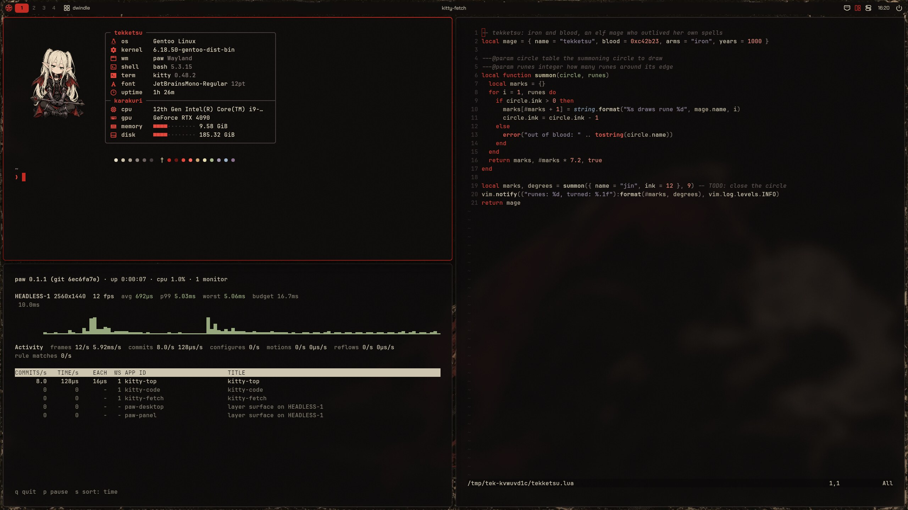
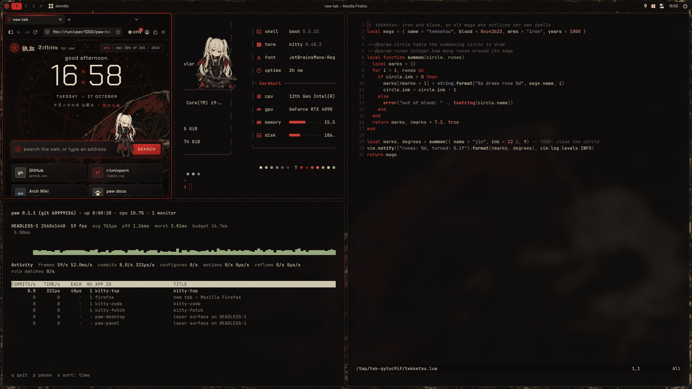
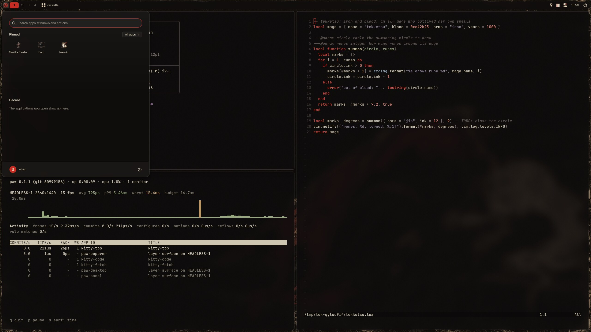
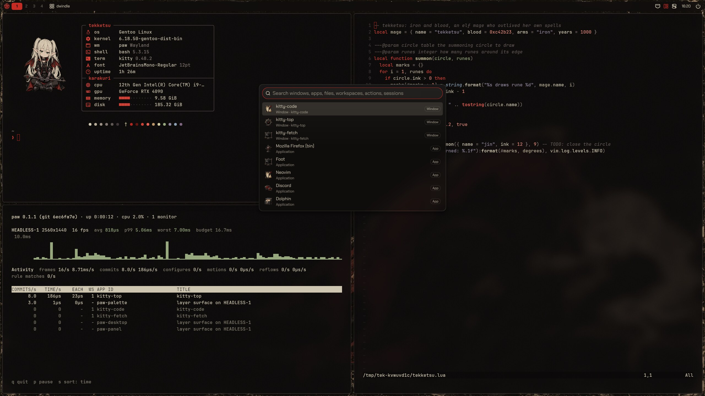
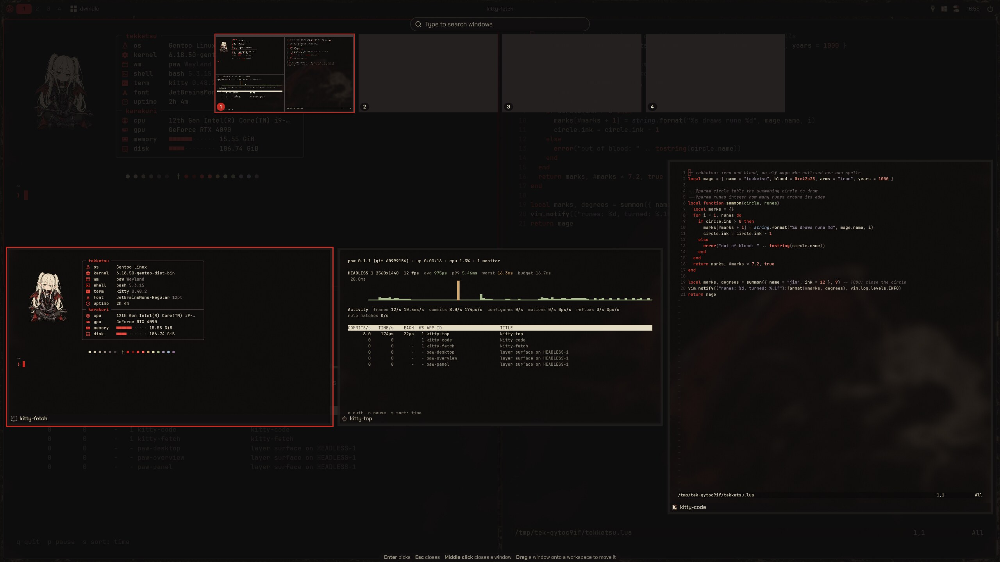
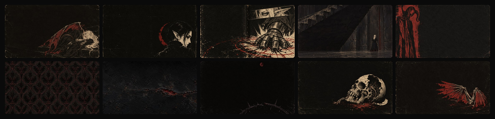
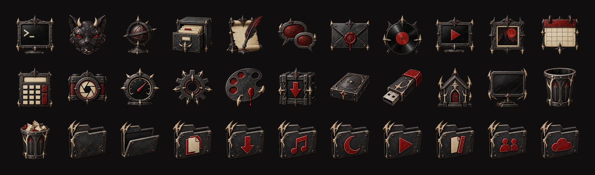
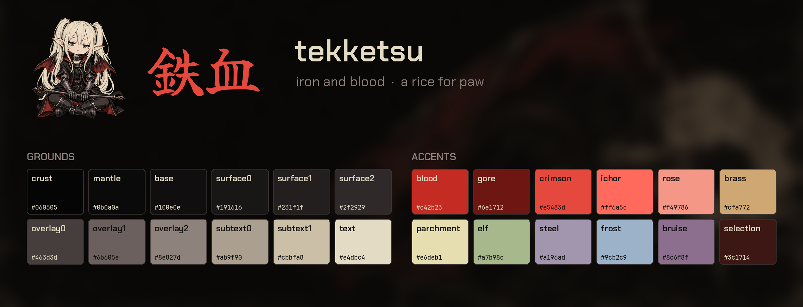

<div align="center">

# 鉄血 tekketsu

<i>Iron and blood.</i>

A rice for [paw](../../README.md): cracked black iron, bone-white text, and blood red as the one
hot colour, with the look of a black-metal shirt print. Its mascot is a small elf mage who has
outlived her own spells, with iron arms, bony red wings and nothing to say about it. *Tekketsu* is
Japanese for iron and blood.



</div>

## The look

tekketsu is dark, warm and heavy. The grounds are the near-black of old lacquer, scratched and
cracked, never blue; the text is the cream of old bone; and blood red is the accent everywhere
something has your attention: the focused window's border (drying down into gore), the current
tab, the cursor, the selection in a menu, the summoning circle on the start button. Where red has
to be read as text it brightens to crimson. The rest of the palette is taken from the mage: brass
from her skin in sepia print, parchment from her hair, the violet steel of her iron arms for
strings, the green of her eyes for what was added, and a cold frost blue (she is the kind of
mage who freezes things) for links and for you.

Terminals, editors and Firefox's toolbars are black-iron glass, which paw blurs and darkens over
the wallpaper behind them. The corners are nearly square, the shadows deep and short. The mage
turns up where she can: in fastfetch, sitting cross-legged with her staff, and on the Firefox
start page, sitting on the edge of the search card with her legs dangling.

| | |
| --- | --- |
|  |  |
| Firefox and its start page, the mage on the search card | The start menu on glass, with the Tekketsu icons |
|  |  |
| The command palette | The overview |







## The palette

| | Grounds | | | Accents | |
| --- | --- | --- | --- | --- | --- |
| crust | `#060505` | the deepest shadow | blood | `#c42b23` | the accent |
| mantle | `#0b0a0a` | floats, sidebars | gore | `#6e1712` | the end of a gradient, pressed |
| base | `#100e0e` | the ground | crimson | `#e5483d` | red that is read: keywords, errors |
| surface0 | `#191616` | cards, the cursor line | ichor | `#ff6a5c` | the brightest red, sparingly |
| surface1 | `#231f1f` | raised | rose | `#f49786` | numbers and constants |
| surface2 | `#2f2929` | selected, inactive borders | brass | `#cfa772` | types, warnings |
| overlay0 | `#463d3d` | rules, scrollbars | parchment | `#e6deb1` | headings, definitions |
| overlay1 | `#6b605e` | comments | elf | `#a7b98c` | success, additions |
| overlay2 | `#8e827d` | muted text | steel | `#a196ad` | strings |
| subtext | `#ab9f90`, `#cbbfa8` | secondary text | frost | `#9cb2c9` | links, you |
| text | `#e4dbc4` | bone | bruise | `#8c6f8f` | sparingly |
| | | | selection | `#3c1714` | a dried-blood wash |

## What is in it

| Part | Files | What it does |
| --- | --- | --- |
| paw | the `tekketsu` profile in [`config/init.lua`](../../config/init.lua), and [`start/`](start) | The black-iron glass bar, blood-to-gore borders, deep shadows, colours, font, wallpaper and a summoning circle on the start button (`shell.start_icon`; a horned iron helm, `start/kabuto.png`, waits beside it). Shipped with paw. |
| Wallpapers | [`wallpaper/`](wallpaper) | Ten, each drawn as a different printed or inked thing: `tekketsu.jpg` (the mage asleep under her wings), *yokogao* (a face half turned away), *mihiraki* (a manga spread, an iron hand in the circle), *kaidan* (an old anime cel, the mage small at the foot of the stairs), *hanga* (a woodcut demon), *donsu* (a damask of thorns and wings), *sabi* (cracked iron with one seam of blood, calm enough to work on), *tsuki* (a blood moon over a crown of thorns), *dokuro* (a skull that was once a machine) and *hane* (the wings alone). |
| kitty | [`kitty/tekketsu.conf`](kitty/tekketsu.conf) | Black-iron glass at 80% with the editors' floats and status lines kept glass too (`transparent_background_colors`), JetBrains Mono, bone text, a blood-red cursor smearing gore, iron tabs with the current one cut in blood, and sixteen colours where the reds carry the blood. |
| fastfetch | [`fastfetch/`](fastfetch) | The mage, shown through kitty's graphics protocol, beside a spec sheet in a box, the hardware under *karakuri* (the mechanism), and the palette in a row behind a dagger. |
| Firefox | [`firefox/`](firefox) | `userChrome.css` (black-iron glass toolbars, the page a plate set into them, the current tab and the focused URL bar cut in blood), `userContent.css` (the new tab page and the settings pages in tekketsu), `user.js`, and a start page: a summoning circle turning slowly in faint blood behind a big clock, ash falling, riveted iron cards, and the mage on the search card, whose wings flick and whose circle flares when you pat her. |
| Discord | [`discord/tekketsu.theme.css`](discord/tekketsu.theme.css) | One theme for Vencord, Vesktop, Equicord, Equibop and BetterDiscord: Discord's dark themes become tekketsu, scratched iron behind the chat, a summoning circle half off its corner, blood where it matters, and with window transparency on, glass. |
| Claude Code and cdeck | [`claude/tekketsu.json`](claude/tekketsu.json) | A custom theme for Claude Code (`/theme`, then `custom:tekketsu`), which cdeck takes its colours from: Claude in crimson, you in frost, a blood-red Clawd. |
| Neovim and Helix | [`editors/`](editors) | Plugin-free colour schemes, keywords in crimson, types in brass, strings in steel and definitions in parchment, that paint no background, so kitty's glass shows through the code. |
| GTK | [`gtk/gtk.css`](gtk/gtk.css) | Iron, bone and a blood accent for libadwaita applications through libadwaita's own colour variables, only while the system prefers dark. |
| Icons | [`icons/Tekketsu`](icons/Tekketsu) | `Tekketsu`, an icon theme of 33 applications, places and devices forged in black iron with blood-red enamel, folders with little bony wings, kitty as a horned iron cat, over a Tela recoloured to match. Firefox, Discord, Dolphin, Nautilus, foot, Neovim and a few others take its generic browser, chat, file manager, terminal and editor icons, so the start menu matches. |

## Using it

**paw.** The profile ships with paw: pick **tekketsu** from the panel's Appearance menu or the
command palette, or run `paw msg profile tekketsu`. A configuration with `extends = "default"`
and no profiles of its own offers it. One with profiles of its own copies `tekketsu` from
[`config/init.lua`](../../config/init.lua) into its `profiles` table and names the pictures by
their installed paths, for example
`wallpaper = "/usr/share/paw/rices/tekketsu/wallpaper/tekketsu.jpg"` (`/usr/local/share` for a
build installed with the default prefix). The profile sets the system to prefer dark
(`appearance.color_scheme`), which GTK, Firefox and Discord follow.

**The applications.** `install.sh` puts the rest in place; it is installed with paw at
`share/paw/rices/tekketsu/install.sh`, or run it from here:

```sh
rices/tekketsu/install.sh --dry-run       # what it would change
rices/tekketsu/install.sh                 # kitty, fastfetch, Firefox, Discord, Claude Code, editors, GTK, wallpapers
rices/tekketsu/install.sh kitty discord   # only some of them
rices/tekketsu/install.sh --fonts --icons --cursor
```

It keeps a copy of every file it replaces (`FILE.tekketsu-backup`, the first time), puts the
lines it adds to your own files between `paw tekketsu` markers, and changes nothing new when run
again. It leaves paw's configuration and Discord itself alone. The wallpapers go where paw's
wallpaper picker looks, in a `tekketsu` folder of their own: `Pictures/wallpapers/tekketsu`, or
`Pictures/tekketsu` when there is no `wallpapers` folder. What the options download, each pinned
to a release or a commit:

- `--fonts`: Chakra Petch (the bar's squared, machined sans, Firefox's and Discord's too, as
  single weights from [google/fonts](https://github.com/google/fonts/tree/690b65d64dabaebf9d18e2d7e8c8e7e02b4cccaf/ofl/chakrapetch)),
  UnifrakturMaguntia (a blackletter for the few big headings), Yuji Syuku (鉄血 and the other
  Japanese in a brush hand), JetBrains Mono 2.304 and the Nerd Fonts 3.5.1 symbols, about 18 MB,
  into `~/.local/share/fonts/paw-tekketsu`. All under the SIL Open Font License, the symbols
  under MIT.
- `--icons`: the [Tela icon theme](https://github.com/vinceliuice/Tela-icon-theme) (2026-07-07),
  installed with its folders in iron and their symbols in blood as `Tela-tekketsu-black` (and
  `-light`, `-dark`), and over it tekketsu's own icons as `Tekketsu` (`icons/Tekketsu`), which
  fills in from `Tela-tekketsu-black-dark`: uncomment `icon_theme = "Tekketsu"` in the
  `tekketsu` profile to have it while tekketsu is in use, or
  `gsettings set org.gnome.desktop.interface icon-theme Tekketsu` to keep it.
- `--cursor`: [Bibata](https://github.com/ful1e5/Bibata_Cursor) Modern Classic 2.0.7, black with
  a white edge: add `cursor_theme = "Bibata-Modern-Classic"` to the `tekketsu` profile's
  `appearance`, or
  `gsettings set org.gnome.desktop.interface cursor-theme Bibata-Modern-Classic`.

**The glass.** paw blurs what shows through a translucent window. kitty is translucent as it
is (kitty 0.37 or newer keeps the editors' floats and status lines glass too), and Neovim and
Helix paint no background of their own; in a terminal without translucency, give it tekketsu's
base, `#100e0e`. Firefox's toolbars are glass while `tekketsu.glass` is true in `user.js` (it
is); set it to false for solid toolbars.

**Discord** cannot load a theme itself: `install.sh` puts it in the themes folder of Vencord,
Vesktop, Equicord, Equibop or BetterDiscord where one is installed, and you turn it on in their
settings, with Discord on a dark theme (Appearance → Dark, or Sync with computer). For glass,
turn on **Enable window transparency** in Vencord's (or Equicord's) settings, restart Discord,
and put this in QuickCSS:

```css
:root { --tekketsu-glass: 1; }
```

0 is solid (the default, and the right value without window transparency), 1 tekketsu's glass,
and values in between work too. `--tekketsu-scratches` (0 to 2) sets how scratched the iron
behind the chat is, and `--tekketsu-sigil: none` takes the summoning circle away. Client mods
are against Discord's terms.

**Firefox** picks the theme up when it restarts. The first tab and every new tab show Firefox's
own new tab page, styled to match the start page; to open the start page itself at home instead,
uncomment its line in `user.js`. tekketsu's Firefox chrome is dark whatever the system prefers.
Firefox's own minimise, maximise and close buttons are hidden, their place kept for paw's: the
window rule `{ app_id = "^firefox", controls = true }` in `windows.rules` puts paw's controls
there, shown as the pointer nears the corner, as over kitty.

**GTK.** The lines `install.sh` adds to `~/.config/gtk-4.0/gtk.css` recolour libadwaita 1.6
and newer through its colour variables while the system prefers dark, and leave its shapes
alone. GTK 3 applications keep their theme.

**Beside the other rices.** The rices install side by side, but some places hold only one look:
Firefox's `chrome/` folder takes the last one installed; kitty uses whichever block comes last in
`kitty.conf`; and GTK 4 the last block in `gtk.css` (remove the others' blocks, or run that
rice's `install.sh` part again). In Discord, turn on one theme at a time.

## What paw does for it

- **`windows.blur`**, the wallpaper blurred behind windows: kitty, the editors in it, Firefox's
  toolbars and Discord with transparency let it through, frosted and darkened, with a grain.
- **`shell.blur`**, glass for the bar and every popup: the start menu, Quick Settings, the
  calendar, notifications, the command palette and Alt + Tab.
- **Gradient borders**, blood drying down into gore on the focused window.
- **`appearance.ambient`** and **`appearance.cursor_trail`**: ash drifting down through the dark
  with a few embers still alight in it (`kind = "embers"`, fewer and slower than hibana's), and
  blood-red sparks flung off the pointer as off a grinder (`cursor_trail`'s `"sparks"` with
  tekketsu's reds as its `colors`). The profile suggests them in comments;
  `paw msg ambient embers` and `paw msg cursor_trail sparks` try them for the session.
- **`shell.start_icon`** puts the summoning circle on the start button.
- **`appearance.color_scheme = "dark"`** takes GTK, Firefox and Discord into their dark styles
  with the profile.
- **Profiles** switch all of it at once.

## Credits

The palette, the themes and everything else here are paw's and under its licence,
GPL-3.0-or-later; the wallpapers, the start button, the fastfetch picture, the start page's mage
and the `Tekketsu` icons are made for paw, the pictures with OpenAI's image model through Codex.
The look was inspired by black-metal band merch and by fan art of an anime's elf mage; the mage
here is paw's own, and no name, logo or mark of either is used. The wallpapers are 1672 by 941
for now, the size that model draws. Nothing else is bundled: the fonts (Chakra Petch by
Cadson Demak; UnifrakturMaguntia by j. 'mach' wust; Yuji Syuku by Kinuta Font Factory;
JetBrains Mono by JetBrains; the Nerd Fonts symbols), the Tela icons (vinceliuice, GPL-3.0) and
the Bibata cursors (Abdulkaiz Khatri, GPL-3.0) are downloaded by `install.sh` from their own
releases, under their own licences.
