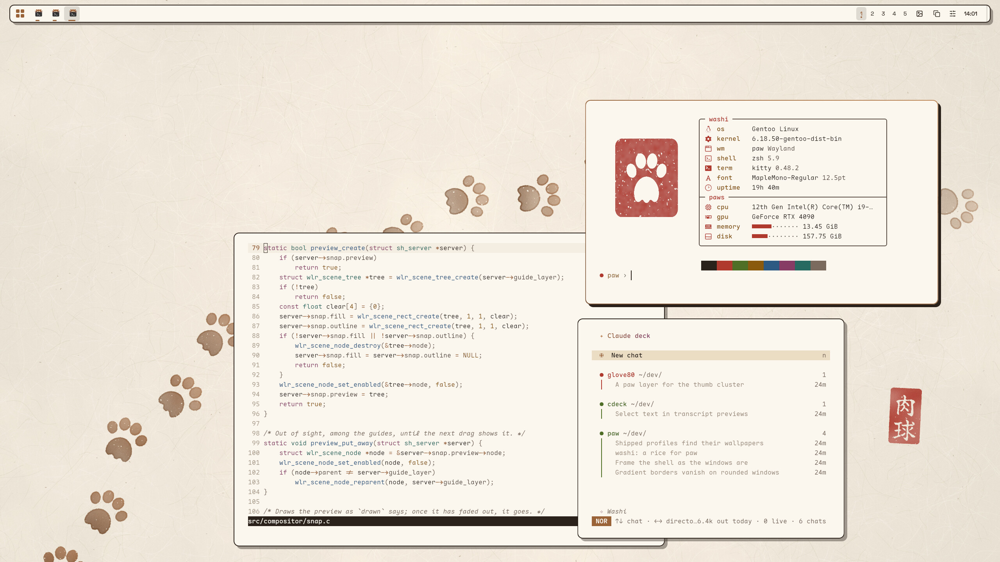
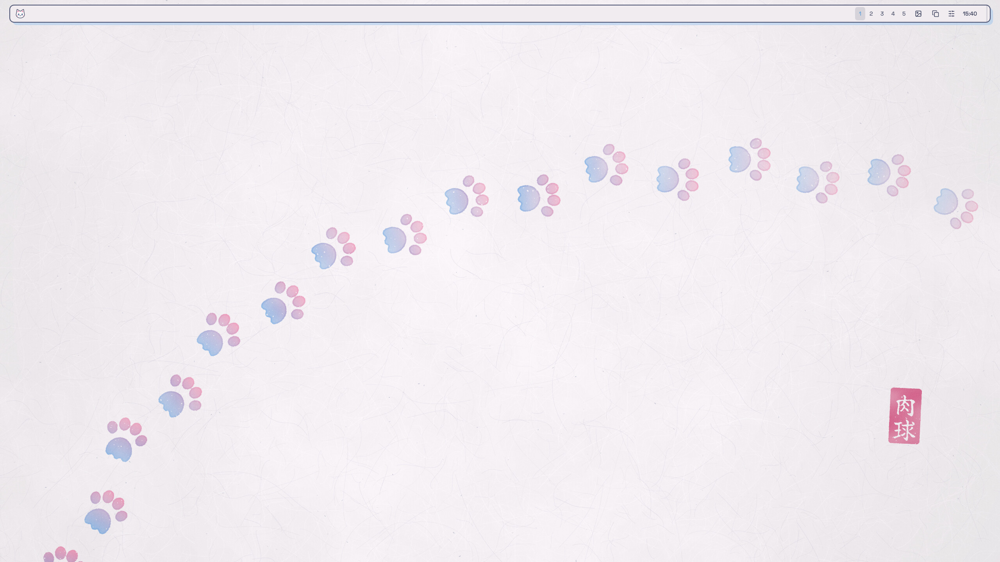
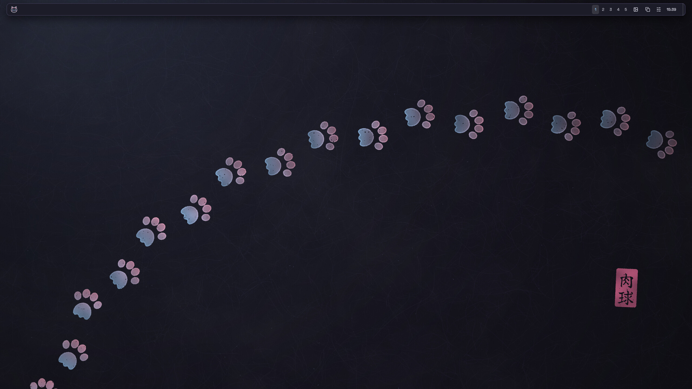
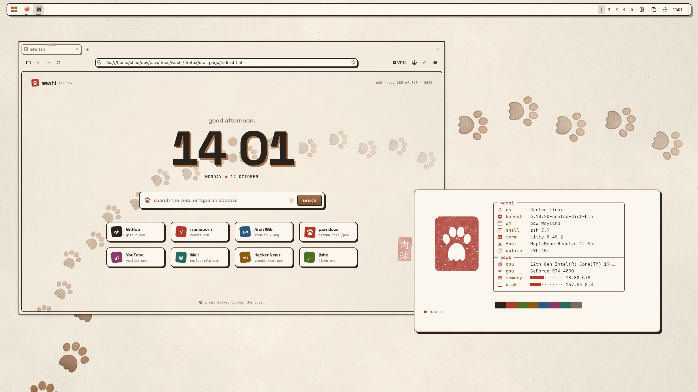
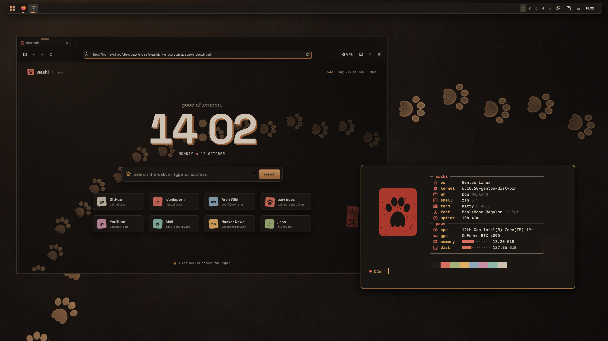
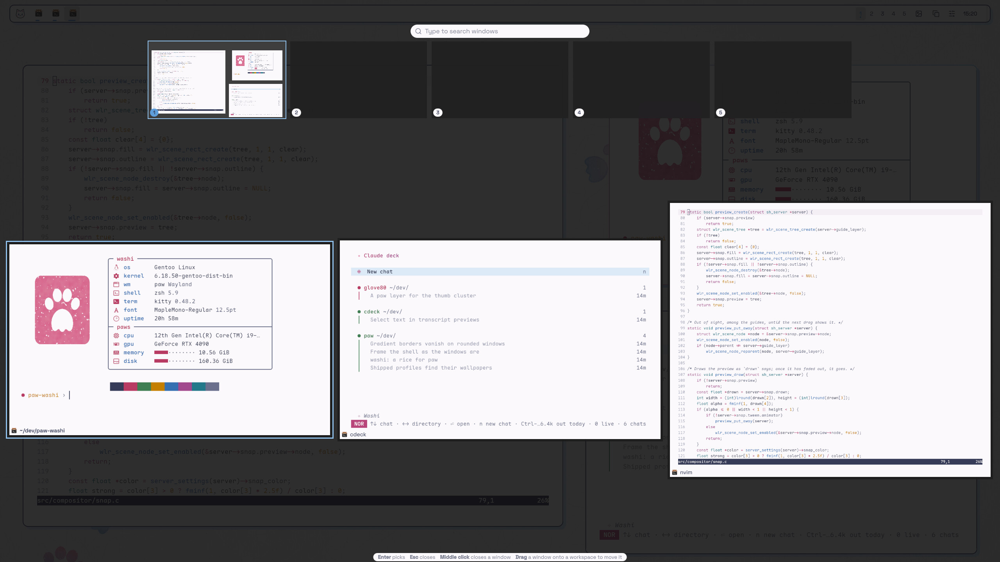
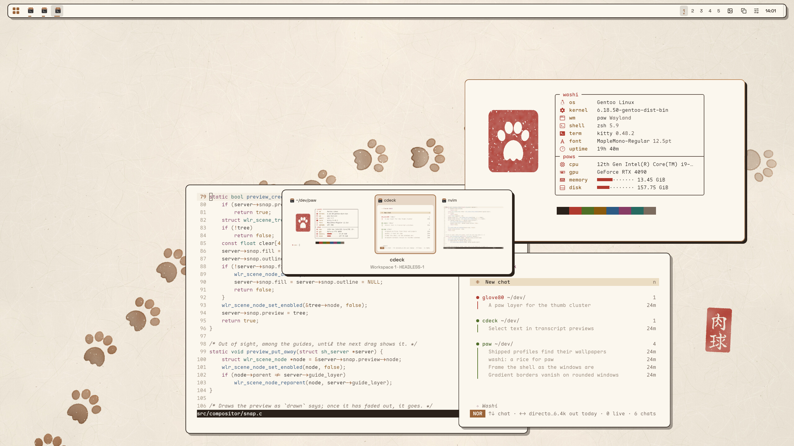
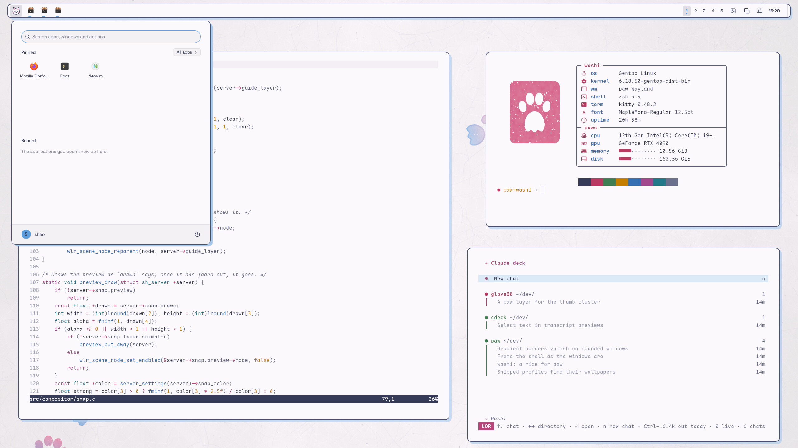
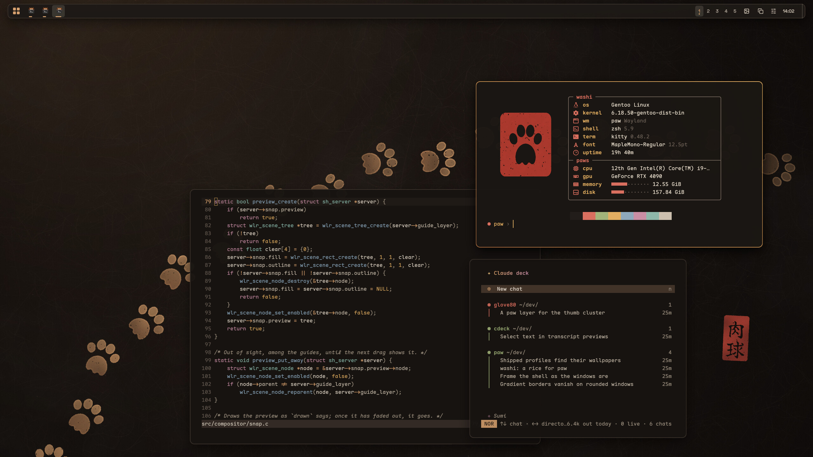
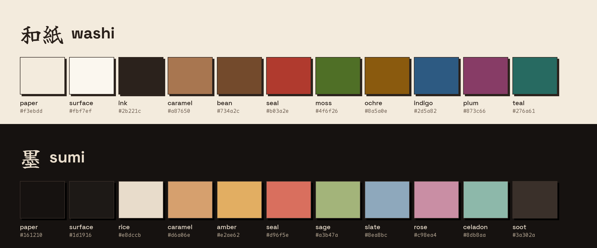

<div align="center">

# 和紙 washi

<i>A cat walked across the paper.</i>

A rice for [paw](../../README.md): handmade cream paper with ink outlines, printed shadows and
the caramel of paw's toe beans by day, and **墨 sumi**, the same sheet soaked in ink under a lamp,
by night.



</div>

## The look

Every part of the desktop is drawn as print: windows, the bar and every menu carry a 2 pixel ink
outline and a hard shadow set beside them rather than under them, the focused window's border
runs in the caramel gradient of the logo's toe beans, and the one loud colour is the vermilion of
a hanko seal. The wallpaper is a sheet of washi with its kozo fibres, the trail of a cat that
walked across it while the ink was wet, and a seal reading 肉球 (nikukyū, paw pads). It is
generated from a seed, so it ships with paw under its licence.

| | |
| --- | --- |
|  |  |
| The desktop, washi | The desktop, sumi |
|  |  |
| Firefox and its start page | The same at night |
|  |  |
| The overview, in the profile's colours | Alt + Tab with live pictures of the windows |
|  |  |
| The start menu, framed as the windows are | sumi at work |



## What is in it

| Part | Files | What it does |
| --- | --- | --- |
| paw | the `washi` and `sumi` profiles in [`config/init.lua`](../../config/init.lua) | The floating bar, borders, shadows, colours, font and wallpaper. Shipped with paw. |
| Wallpapers | [`wallpaper/`](wallpaper) | `washi.jpg` and `sumi.jpg` at 3840 by 2160, and `generate.py`, which draws them. |
| kitty | [`kitty/`](kitty) | Both palettes, Maple Mono, padding, a vermilion (or caramel) cursor trail, a quiet scrollbar and ink tabs. |
| fastfetch | [`fastfetch/`](fastfetch) | The seal with the paw cut out, shown through kitty's graphics protocol, beside a spec sheet in a box. |
| Firefox | [`firefox/`](firefox) | `userChrome.css` (the URL bar as a card, tabs as paper labels with a strip of washi tape, menus framed in ink), `userContent.css` (the new tab and settings pages), `user.js`, and a start page: a big clock, a search card, stamped links and a trail of paw prints wherever you click. |
| Discord | [`discord/washi.theme.css`](discord/washi.theme.css) | One theme for Vencord, Vesktop, Equicord, Equibop and BetterDiscord: Discord's light theme becomes washi and its dark ones sumi. |
| Claude Code and cdeck | [`claude/`](claude) | Custom themes for Claude Code (`/theme`, then `custom:washi` or `custom:sumi`), which cdeck takes its colours from. |
| Neovim and Helix | [`editors/`](editors) | Plugin-free colour schemes for both: ink text, plum keywords, moss strings, indigo functions, comments pencilled in. |

## Using it

**paw.** The profiles ship with paw: pick **washi** or **sumi** from the panel's Appearance menu
or the command palette, or run `paw msg profile washi`. A configuration with
`extends = "default"` and no profiles of its own offers them. One with profiles of its own copies
the two from [`config/init.lua`](../../config/init.lua) into its `profiles` table and names the
wallpaper by its installed path, for example
`wallpaper = "/usr/share/paw/rices/washi/wallpaper/washi.jpg"` (`/usr/local/share` for a build
installed with the default prefix).

**The applications.** `install.sh` puts the rest in place; it is installed with paw at
`share/paw/rices/washi/install.sh`, or run it from here:

```sh
rices/washi/install.sh --dry-run       # what it would change
rices/washi/install.sh                 # kitty, fastfetch, Firefox, Discord, Claude Code, editors
rices/washi/install.sh kitty firefox   # only some of them
rices/washi/install.sh --fonts --icons --cursor
```

It keeps a copy of every file it replaces (`FILE.washi-backup`, the first time), puts the lines
it adds to your own files between `paw washi` markers, and changes nothing new when run again.
It leaves paw's configuration and Discord itself alone.

- `--fonts` downloads Space Grotesk, Maple Mono and the Nerd Font symbols into
  `~/.local/share/fonts/paw-washi` (all under the SIL Open Font License or MIT).
- `--icons` downloads the [Tela icon theme](https://github.com/vinceliuice/Tela-icon-theme) and
  installs its folders in caramel as `Tela-washi-brown`.
- `--cursor` downloads [Bibata Modern Classic](https://github.com/ful1e5/Bibata_Cursor), black as
  ink.
- `--dark` makes sumi kitty's theme, and `--follow-system` lets kitty switch between the two with
  the system's light or dark preference (these auto themes override every colour kitty.conf sets
  while the system has a preference).

Firefox picks the theme up when it restarts; its start page is the home page, and the new tab
page is styled to match it (Firefox lets a setting change neither). Discord itself cannot load a
theme: `install.sh` puts it in the themes folder of Vencord, Vesktop, Equicord, Equibop or
BetterDiscord where one is installed, and you turn it on in their settings. Client mods are
against Discord's terms. The theme loads Space Grotesk from Google Fonts; delete its `@import`
line if the font is installed or you would rather Discord did not ask Google for it.

## What paw does for it

The rice is mostly settings, and shows off what paw draws itself:

- **`shell.frame = "windows"`** frames the floating bar, the dock and every popup as the windows
  are, with their border and their shadow; the bar's shadow falls past the strip it reserves
  without taking input there.
- **Hard shadows**: `windows.shadow` with `blur = 0` and an `offset` prints the shadow beside the
  window, following its rounded corners.
- **Gradient borders** at an angle, rounded with the window, easing from the inactive colour to
  the focused one.
- **The overview** in the profile's colours, and **Alt + Tab** and the taskbar with live pictures
  of the windows.
- **Profiles** switch all of it at once, and a wallpaper beside the shipped configuration is
  found there.

## Regenerating the wallpapers

```sh
python3 wallpaper/generate.py washi washi.jpg --seal-font YujiSyuku-Regular.ttf
python3 wallpaper/generate.py sumi sumi.jpg --seal-font YujiSyuku-Regular.ttf
python3 wallpaper/generate.py logo fastfetch/logo.png --size 512x512
```

It needs Python with pycairo and Pillow. `--seed` draws another sheet and another walk, and
`--size` any size. The seal's 肉球 was set in [Yuji Syuku](https://fonts.google.com/specimen/Yuji+Syuku)
(SIL Open Font License); without a font that has those characters, the seal carries the paw.

## Credits

Everything here is paw's and under its licence, GPL-3.0-or-later. The wallpapers and the mark are
drawn by `generate.py` from paw's logo. Nothing else is bundled: the fonts (Space Grotesk by
Florian Karsten, Maple Mono by subframe7536, the Nerd Fonts symbols), the Tela icons
(vinceliuice) and the Bibata cursor (ful1e5) are downloaded by `install.sh` from their own releases,
under their own licences.
